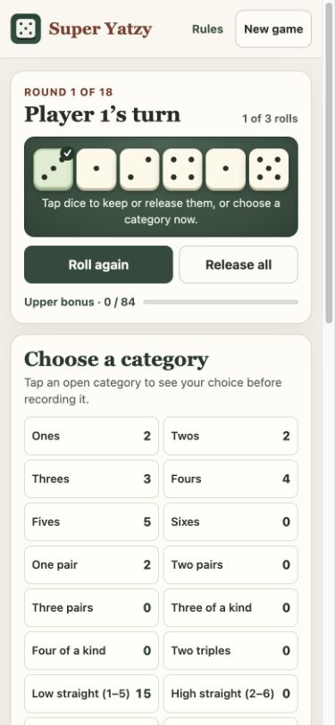

# Super Yatzy

[Play Super Yatzy](https://hanus01.github.io/super-yatzy/) on a phone or computer. Play solo, pass one device around the table, or add a computer opponent. The game has 18 scoring categories, six dice, and a 50-point bonus for an upper score of at least 84.



## Play on iPhone

Open the game in Safari, tap **Share → Add to Home Screen**, enable **Open as Web App** if shown, and tap **Add**. Open the icon once while online so the browser can cache the game files for offline play.

Each player can use the on-screen dice or roll physical dice. With physical dice, choose **Enter score** to type the points you counted. Once you record a valid score, the next turn starts. Choose **Enter dice** to enter the six faces and see your scoring options before choosing a category. With on-screen dice, roll up to three times, tap the dice you want to keep, and choose an unused category. When the computer is next, the skip-animation button plays and scores its turn immediately. After the final scores, **Rematch** starts a new game with the same players and settings. Use **Rules** for scoring details and **Share** to send the game link.

The web game runs on the device. Player names, dice, and scores live in memory for the current session. The offline cache holds the app files. Playing requires no account, server-side game storage, or analytics script.

## Source and tests

- `docs/` contains the installable web version. It uses HTML, CSS, JavaScript, and a service worker, with no package install or build step.
- `game.hpp` and `main.cpp` contain the original C++ rules engine and SFML interface. The Objective-C++ helper in `macos_display.mm` handles native Retina rendering.
- The computer evaluates legal holds and rerolls using their exact dice probabilities. It weighs the current score against the value of saving a category and the chance of earning the upper bonus. Each new game gets fresh randomness. Tests can inject a seed to reproduce a game.

From the repository folder, run the browser engine tests with a current Node.js version:

```sh
node --test tests/game.test.mjs
```

To run the web version locally, start a static server and visit `http://localhost:8000`:

```sh
python3 -m http.server 8000 --bind 127.0.0.1 --directory docs
```

## Build the native Mac app

The native version targets macOS 15 or later. Install the Xcode command-line tools and SFML 2, then run the build script with a compiler that supports C++26:

```sh
xcode-select --install
brew install sfml@2
bash build_macos.sh
```

The script builds and signs a local `Super Yatzy.app` beside the source folder and copies its runtime libraries and notices into the bundle. `SFML_PREFIX` selects a custom SFML installation, `YATZY_BUILD_DIR` selects the build folder, and `YATZY_APP_OUTPUT` selects the app destination. The optional CMake project requires CMake 3.25 or later and the SFML 2 prefix.

Graphics and windowing in the Mac app use [SFML 2.6](https://www.sfml-dev.org/). The Mac bundle also includes FreeType and libpng dependencies. Their notices are in `licenses/`. The Mac app uses system fonts.
